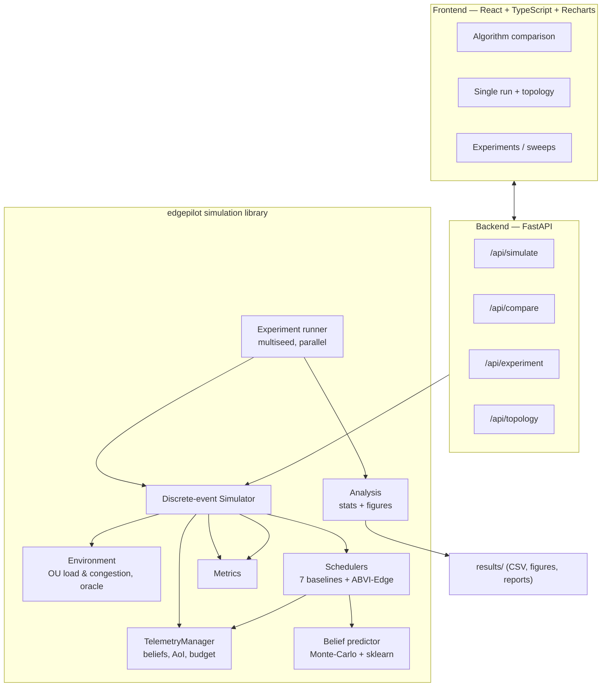
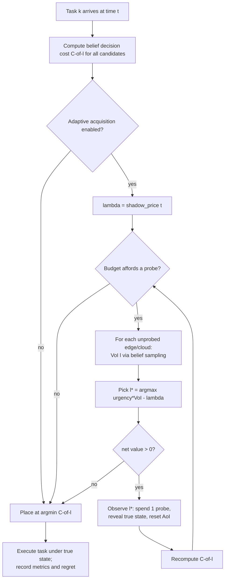
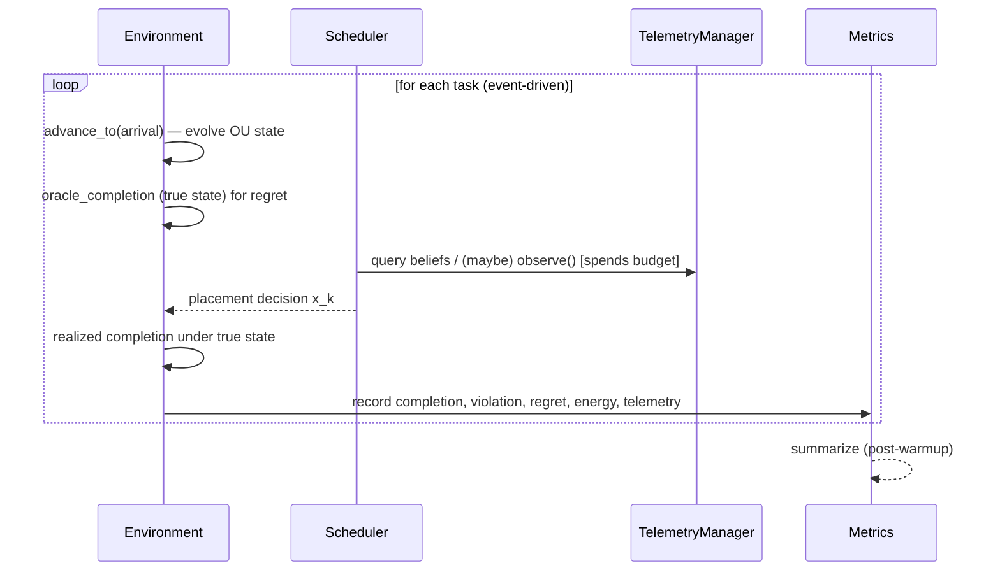
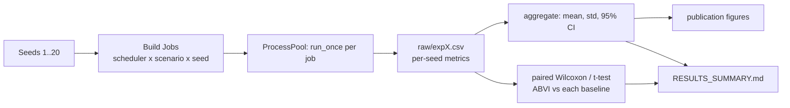

# EdgePilot — Diagrams

Mermaid diagrams (render on GitHub/VS Code Markdown preview).

## 1. System architecture

## 2. ABVI-Edge decision flowchart

## 3. Simulation workflow (per run)

## 4. Experimental methodology

